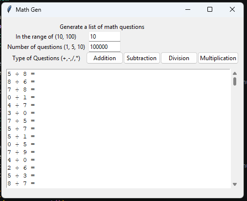

# Maths Question Generator
A simple generator of basic Maths questions

My children often ask for me to write out sets of maths questions for them to complete, 
often is seems to take me longer to decide on exactly which numbers to give them.

To speed this up I created this program, 
now I can generate hundreds of questions in seconds and either print them or complete them directly in the program.

# Usage
You dont need Python installed, the exe is prepackaged simply run it as is... it just works.

performance is very smooth, in my tests I can generate 100000 questions in less than a secound. You know... if you really love maths.

# Code
Coded 100% in Python using the below libaries (Normally included in Python 3 by default)
- Python 3
- Tkinter
- Random